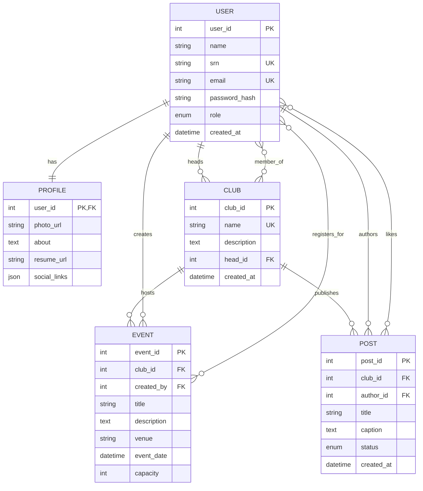

# EvePort: Design Document

## 1. Overview
EvePort is a club and event portal for a university. Students browse clubs, register for events, post and comment; club heads manage members, events and post approvals; admins manage users and clubs.

**Hybrid persistence**
| Store | Holds | Why |
|---|---|---|
| MySQL 8 | USER, PROFILE, CLUB, EVENT, POST, MEMBER_OF, REGISTERS_FOR, LIKES, AUDIT_LOG | Structured, related data that needs keys, constraints, transactions, triggers and joins |
| MongoDB | `user_notifications` (NOTIFICATIONS[]), `post_content` (MEDIA[], COMMENTS[]) | The three *multivalued composite attributes* of the ER diagram: variable-length, schema-flexible, always read together with their owner, no cross-entity joins |

## 2. ER diagram
Entities: USER, PROFILE, CLUB, EVENT, POST. Multivalued composite attributes: NOTIFICATIONS (user), MEDIA and COMMENTS (post).


(Multivalued composite attributes `NOTIFICATIONS`, `MEDIA`, `COMMENTS` are stored in MongoDB.)

## 3. Relational schema (final)
```
USER(user_id PK, name, srn UNIQUE, email UNIQUE, password_hash, role, created_at)
PROFILE(user_id PK/FK→USER, photo_url, about, resume_url, social_links)
CLUB(club_id PK, name UNIQUE, description, head_id FK→USER, created_at)
EVENT(event_id PK, club_id FK→CLUB, created_by FK→USER, title, description, venue, event_date, capacity)
POST(post_id PK, club_id FK→CLUB, author_id FK→USER, title, caption, status, created_at)
MEMBER_OF(user_id FK→USER, club_id FK→CLUB, joined_at)            PK(user_id, club_id)
REGISTERS_FOR(user_id FK→USER, event_id FK→EVENT, registered_at, attendance_status)  PK(user_id, event_id)
LIKES(user_id FK→USER, post_id FK→POST, created_at)               PK(user_id, post_id)
AUDIT_LOG(log_id PK, table_name, record_id, action, details, logged_at)   -- filled by trigger
```
MongoDB:
```
user_notifications { user_id, notifications:[{notification_id, message, is_read, created_at}] }
post_content       { post_id, media:[{media_id, url, media_type}],
                     comments:[{comment_id, user_id, parent_comment_id, text, created_at, edited_at?}] }
```
`user_id` / `post_id` in Mongo reference the MySQL keys. Mongo cannot enforce foreign keys, so the API checks the post exists (and is published) in MySQL before writing a comment, and deletes a user's notification document when the user is deleted.

### Constraints
PK/FK with ON DELETE rules (CASCADE for dependants, RESTRICT for `head_id`, `created_by`, `author_id`); UNIQUE (srn, email, club name, event club+title+date); CHECK (capacity > 0, email format, SRN pattern, non-admins must have an SRN); ENUMs for role, post status, attendance status.

### Changes made to the first SQL file
1. `POST.status` was `draft/published/archived` but the approval workflow needs `pending/published/rejected/archived`.
2. Role enum: removed `faculty` (unused) and the old `club_member` idea. Membership is *derived* from `MEMBER_OF`, so a student can belong to many clubs without a role change.
3. Added CHECK constraints (SRN, email, role/SRN rule) and a UNIQUE on events.
4. The three multivalued tables moved to MongoDB (hybrid requirement).
5. Added `AUDIT_LOG`, indexes, and a view.
6. Seed data: real bcrypt hashes (password `Password@123`), three extra students.

## 4. Technology justification
* **MySQL** for users, clubs, events, registrations and likes: these are strongly related and need integrity (a registration without a user/event is invalid), transactions (the last seat must go to exactly one student) and joins/aggregates for reports.
* **MongoDB** for notifications, media and comments: each is a growing list owned by one parent (a user or a post) and always fetched with it. A single document read replaces a join, new media kinds or fields need no migration, and comment edits are single-document atomic updates.
* **Next.js**: one codebase for UI and REST API (route handlers), file-based routing, and middleware for the auth gate.

## 5. Where each rubric item lives
| Rubric item | Where |
|---|---|
| ER diagram, relational schema | this file; `docs/` |
| SQL DDL with constraints | `db/mysql/01_schema.sql` |
| NoSQL creation | `db/mongo/eveport_mongodb.js` (validators, indexes, seed) |
| DML | `db/mysql/05_queries.sql` §A |
| Nested / correlated / recursive / joins | `05_queries.sql` §B–G; also `app/api/reports/route.js` |
| Procedures, functions, triggers, CTE | `db/mysql/03_routines.sql`, `05_queries.sql` §E–F |
| NoSQL feature + RUD | Mongo script §7; `app/api/posts/[id]/comments/**`, `app/api/notifications/route.js` |
| Next.js interface, API integration | `app/**` |
| Authentication, roles, DB RBAC | `lib/auth.js`, `middleware.js`, `db/mysql/04_rbac.sql`, `lib/mysql.js` |
